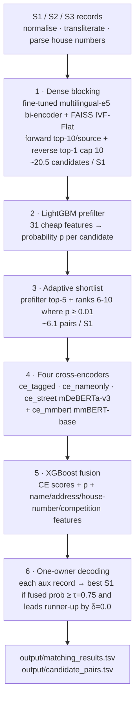

# Business Entity Resolution

> Matching noisy business records across three independent data sources — a dense-retrieval + transformer cross-encoder pipeline that reaches **0.9907 macro F0.5** on a frozen, test-density holdout.

[](https://www.python.org/)
[](https://developer.nvidia.com/cuda-toolkit)
[](LICENSE)
[](#models)

This repository is the solution of team **iiit_fishes** for the **ML Challenge 2026 — Business Entity Resolution** task. It is a complete, reproducible machine-learning pipeline that, given business records from three independent and noisy data sources, decides which records across sources refer to the same real-world business.

---

## Table of contents

- [The problem](#the-problem)
- [Results](#results)
- [How it works](#how-it-works)
- [Repository structure](#repository-structure)
- [Setup](#setup)
- [Data](#data)
- [Models](#models)
- [Reproducing the results](#reproducing-the-results)
- [Key design decisions](#key-design-decisions)
- [Documentation](#documentation)
- [Team](#team)
- [License](#license)

---

## The problem

Large commercial platforms ingest business identity data from many independent sources. Each source contributes partial, noisy fragments about the same real-world businesses, and the fragments **share no common identifier**. Deciding which records describe the same business is the task of **Entity Resolution (ER)**.

- **Source 1 (`S1`)** is a deduplicated reference source. For every `S1` entity we must find all matching records from **Source 2 (`S2`)** and **Source 3 (`S3`)**. An `S1` entity may match zero, one, or many `S2`/`S3` records.
- Records are **noisy**: name typos, legal-suffix and abbreviation variation (`Pvt Ltd`, `LLC`, `SARL`, `& Co`), transliteration and native-script (Indic) names, alias/DBA brand names, reordered and abbreviated addresses, landmark references, and house numbers that are zero-padded, truncated, shifted, or missing. About **4.4%** of auxiliary records have an empty address.
- **Train** covers `US` and `India`; the **test** set adds a third country, **`France`, unseen in training** — the pipeline treats `country` as an open set and never hard-codes to `{US, India}`.
- No external data lookups are allowed — the solution uses only the provided data.

**Evaluation metric — macro F0.5** (precision-weighted, so false merges are penalised ~2× more than misses):

```
F0.5 = (1.25 · Precision · Recall) / (0.25 · Precision + Recall)
```

computed per `S1` entity and averaged over all `S1` (singletons included: correctly predicting "no match" scores a full 1.0).

---

## Results

Frozen, entity-level, **test-density holdout** (220k `S1`, full-size index, all entities competing):

| Metric | Value |
| --- | ---: |
| **Macro F0.5 (headline)** | **0.9907** |
| Precision / Recall | 0.9988 / 0.9724 |
| Accuracy on `S1` with no true match (singletons) | 0.9959 |
| Macro F0.5 — US / India | 0.9902 / 0.9915 |
| Blocking oracle F0.5 (perfect matcher on candidates only) | 0.9982 |
| Candidates per `S1` (blocking) | ~20.3 |
| Cross-encoder shortlist pairs per `S1` | ~5.8 |
| True pairs covered by the shortlist | ~99% |

Validation is deliberately run under **test conditions**: blocking searches the full-size train index and decoding lets all ~2.2M train `S1` compete for each auxiliary record, so local scores track the leaderboard rather than flatter an easier subset.

---

## How it works

A six-stage pipeline: **dense blocking → LightGBM prefilter → adaptive shortlist → four transformer cross-encoders → XGBoost fusion → one-owner decoding.**



1. **Dense blocking.** A `multilingual-e5-base` bi-encoder, fine-tuned on the dev split, embeds `name | address`. FAISS IVF-Flat (nprobe 64) retrieves **forward** top-10 candidates per source for each `S1`, and a **reverse** pass lets each aux record nominate its best `S1` (capped at 10/`S1`) to rescue records dominated by look-alikes. ~20.5 candidates per `S1`; oracle F0.5 on this set is 0.9982.
2. **LightGBM prefilter.** 31 cheap features (dense score, ranks, reverse flags, competition gap/margin, name/address/number similarity) give a probability `p` for every candidate.
3. **Adaptive shortlist.** Keep prefilter top-5, plus ranks 6–10 where `p ≥ 0.01` — ~99% true-pair coverage at ~6 pairs per `S1`.
4. **Four cross-encoders** jointly read both records (`name: … | address: …`):
   - **`ce_tagged`** — mDeBERTa-v3-base; empty aux address → both addresses become `[MISSING]`.
   - **`ce_nameonly`** — mDeBERTa-v3-base for empty-address pairs, with same-name twins as hard negatives.
   - **`ce_street`** — mDeBERTa-v3-base trained with 598k same-name / different-street-or-number non-matches.
   - **`ce_mmbert`** — mmBERT-base trained on 2.9M clean pairs, name-suffix-variation matches up-weighted.
5. **XGBoost fusion** (depth 8, 600 rounds) over the cross-encoder scores, `p`, and name / address / house-number (dedicated parser) / competition features → one probability per pair.
6. **One-owner decoding.** Each aux record goes to its best `S1` when the fused probability ≥ `τ = 0.75` and leads the runner-up by ≥ `δ = 0.0`. One `S1` can own many aux records; each aux record has at most one owner.

See [`docs/methodology.md`](docs/methodology.md) for the full write-up and [`docs/reports/`](docs/reports) for the dated experiment journal behind these choices.

---

## Repository structure

```
business-entity-resolution/
├── README.md                 # this file
├── LICENSE                   # MIT
├── requirements.txt          # pinned deps (Python 3.11, CUDA 12.4)
├── run_training.sh           # train data → all models/ (full retraining, ~15-20 h on 1-2 A100)
├── run_inference.sh          # test data → output/ (~6-8 h on one A100) + official validator
├── src/
│   ├── common/               # data loading, text normalisation/transliteration, house-number parser (hn2)
│   ├── s00..s11_*.py          # training stages (split → blocker → prefilter → cross-encoders → fusion)
│   ├── t01..t04_*.py          # test/inference stages (block → prefilter → shortlist → predict)
│   ├── ce_mdeberta.py         # mDeBERTa-v3 cross-encoder train/score
│   ├── ce_mmbert.py           # mmBERT cross-encoder train/score
│   └── utils/validate_submission.py   # official output validator (stdlib only)
├── models/
│   ├── prefilter_lgbm.txt     # trained LightGBM prefilter (included)
│   ├── fusion/                # trained XGBoost fusion + decoder meta (included)
│   ├── blocker_e5/ ce_*/      # tokenizer/config for each transformer (weights on Hugging Face — see below)
│   └── README.md              # how to fetch the transformer weights
├── data/
│   └── README.md              # where to place the challenge dataset
├── scripts/
│   ├── download_models_from_hf.py   # pull the transformer weights
│   └── upload_models_to_hf.py       # (maintainers) publish the weights
└── docs/
    ├── methodology.md         # full methodology write-up
    └── reports/               # dated experiment reports (blocking, features, ablations, error analysis)
```

---

## Setup

```bash
conda create -n er python=3.11 -y && conda activate er
pip install -r requirements.txt --extra-index-url https://download.pytorch.org/whl/cu124
```

**Hardware:** Linux x86_64, NVIDIA A100 40 GB, CUDA 12.4 (driver ≥ 550) were used. Any GPU with ≥ 24 GB works for inference.

---

## Data

The challenge dataset is **not** included in this repository. Place the provided TSV files under `data/`, keeping the original folder names (see [`data/README.md`](data/README.md)):

```
data/train/train_source1.tsv  train_source2.tsv  train_source3.tsv  train_ground_truth.tsv
data/test/test_source1.tsv    test_source2.tsv    test_source3.tsv
```

All files are **tab-separated** — read them with an explicit `sep="\t"` (addresses and ID lists contain commas).

---

## Models

Every model is **MIT- or Apache-2.0-licensed and ≤ 8B parameters**, per the challenge rules:

| Model | Base | Role | Shipped here |
| --- | --- | --- | --- |
| `blocker_e5` | `intfloat/multilingual-e5-base` | dense blocking bi-encoder | config/tokenizer; weights on HF |
| `ce_tagged` | `microsoft/mdeberta-v3-base` | main cross-encoder | config/tokenizer; weights on HF |
| `ce_nameonly` | `microsoft/mdeberta-v3-base` | empty-address cross-encoder | config/tokenizer; weights on HF |
| `ce_street` | `microsoft/mdeberta-v3-base` | street-aware cross-encoder | config/tokenizer; weights on HF |
| `ce_mmbert` | `jhu-clsp/mmBERT-base` | look-alike cross-encoder | config/tokenizer; weights on HF |
| `prefilter_lgbm` | LightGBM | candidate prefilter | ✅ included (`models/prefilter_lgbm.txt`) |
| `fusion` | XGBoost + logistic decoder | final fusion | ✅ included (`models/fusion/`) |

The five fine-tuned transformer weights total ~5.5 GB — too large for a normal git repo — so they live on the Hugging Face Hub. Fetch them into `models/` with:

```bash
python scripts/download_models_from_hf.py --repo <your-hf-user>/business-entity-resolution-models
```

Or rebuild them from scratch with `bash run_training.sh`. See [`models/README.md`](models/README.md) for details.

---

## Reproducing the results

```bash
# 1) Train every model from the training data (writes models/). Run once.
bash run_training.sh      # ~15-20 h on 1-2 A100 GPUs

# 2) Generate the predictions from the test data.
bash run_inference.sh     # ~6-8 h on one A100
```

`run_inference.sh` prints six steps (blocking → prefilter features → prefilter → shortlist → four cross-encoders → fusion + decoding), writes `output/matching_results.tsv` and `output/candidate_pairs.tsv`, and runs the official validator (expect `PASS`). With the published trained models it regenerates the submitted outputs exactly; transformer training on GPUs is not bit-deterministic, so retrained models reproduce them up to tiny differences.

Validate any output locally before submitting:

```bash
python src/utils/validate_submission.py \
    --matching output/matching_results.tsv \
    --candidate output/candidate_pairs.tsv \
    --test-dir data/test
```

---

## Key design decisions

- **Test-density validation.** A frozen entity-level split (dev 80% / holdout 20% by `sha1(entity_id)`) where blocking searches the full index and all `S1` compete at decoding, so holdout F0.5 tracks the real leaderboard.
- **Bias-free hard-example training.** Cross-encoder training data comes only from `S1` that never compete with evaluation entities, and deliberately includes the failure modes that drive errors: 598k same-name/different-street look-alikes, up-weighted suffix-variation matches, and empty-address twins.
- **A dedicated house-number parser** (`src/common/hn2.py`) that strips zero-padding, excludes unit/floor/PO-box/postal numbers, and matches order-free — the single most informative address signal.
- **Precision-first decoding.** With F0.5 weighting precision 2×, the one-owner + margin rule and `τ = 0.75` abstain on genuinely unresolvable cases (empty-address records whose exact name is shared by multiple `S1`), which is F0.5-optimal.
- **Open-set country handling.** Nothing is hard-coded to `{US, India}`, so the unseen `France` test records flow through the same multilingual pipeline.

---

## Documentation

- [`docs/methodology.md`](docs/methodology.md) — full methodology: problem analysis, blocking, matching model, features, thresholds, results, and error analysis.
- [`docs/reports/`](docs/reports) — the dated experiment journal: blocking recall sweeps, feature ablations, mDeBERTa fusion, top-k sweeps, France diagnostics, and error analysis.

---

## Team

Developed by team **iiit_fishes** for ML Challenge 2026:

- Jazl Anwar (team leader)
- Satvik Mittal
- Arul Thiruvasagam A
- Abhay Trehan

---

## License

Code in this repository is released under the [MIT License](LICENSE). The pretrained model bases (`multilingual-e5-base`, `mdeberta-v3-base`, `mmBERT-base`) are MIT-licensed and remain under their original licenses.
